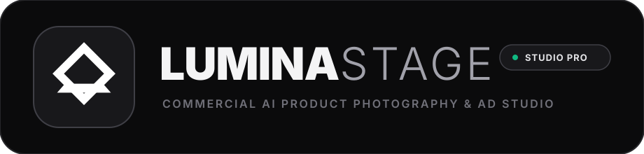
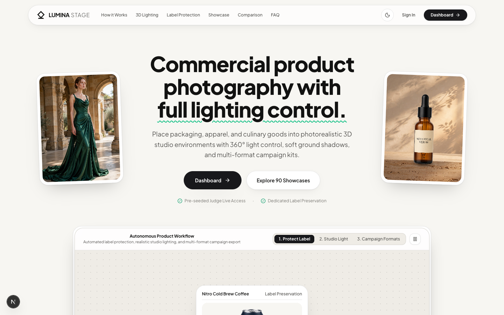
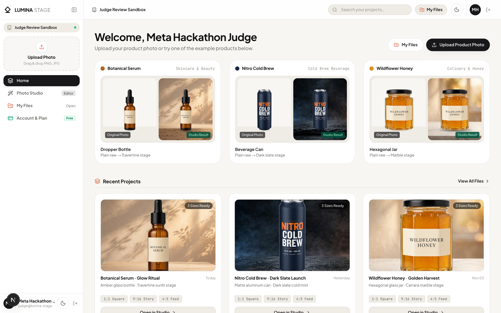
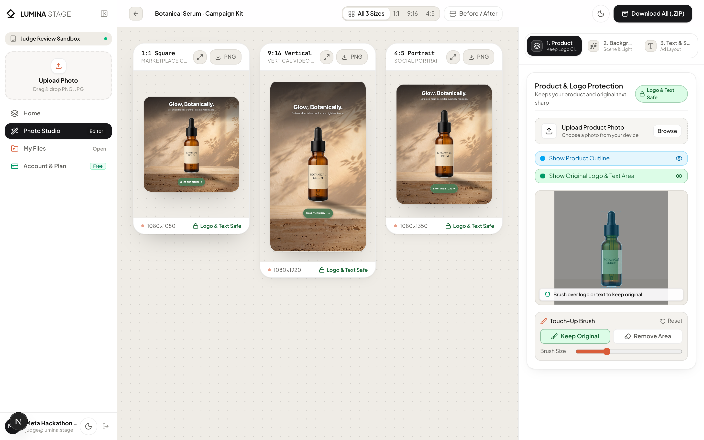
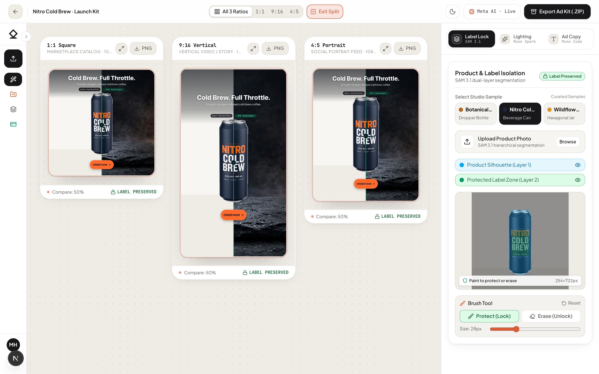
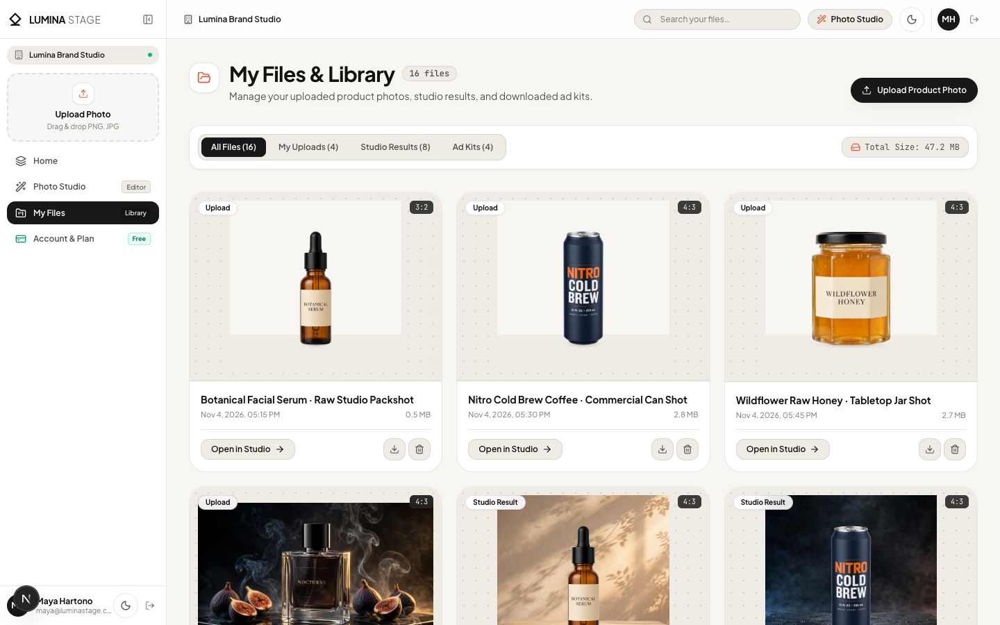
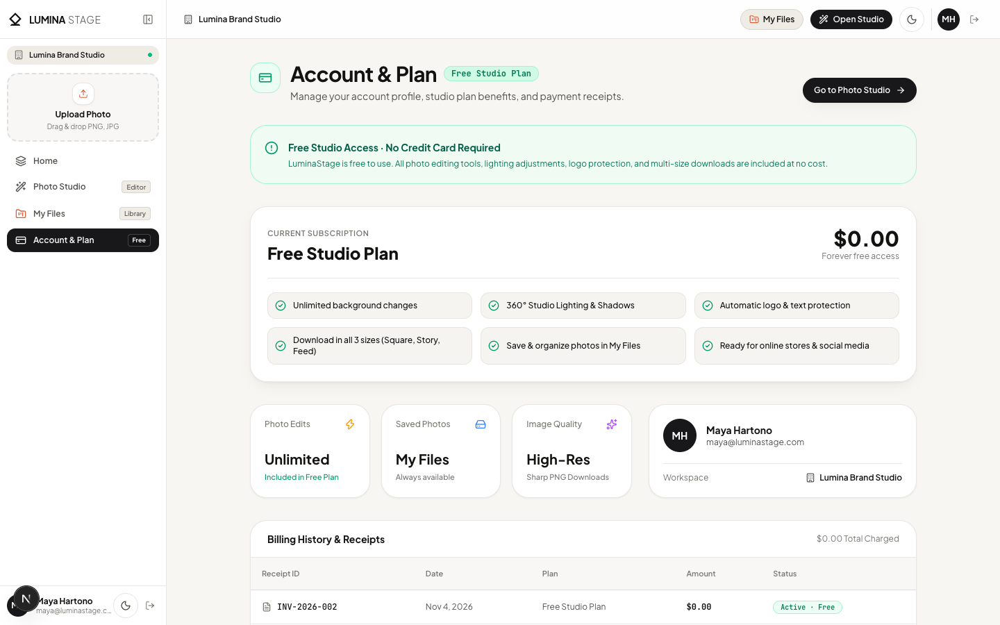

<p align="center">
  
</p>

# LuminaStage: Brand-Safe AI Product Staging & Multi-Channel Ad Studio

**LuminaStage** is an autonomous commercial product staging and multi-channel advertising studio built for e-commerce brands, independent merchants, and performance marketers. Upload a single raw product photo and generate a complete, geometrically relit commercial campaign simultaneously across **Square Marketplace (`1:1`)**, **Reels & Stories (`9:16`)**, and **Social Feed (`4:5`)** while keeping packaging logos and label typography crisp.

* **Live Production Demo:** [https://lumina-stage.rivaldigunawanyusuf.com](https://lumina-stage.rivaldigunawanyusuf.com)

---

## Application Screenshots & Visual Tour

### 1. Commercial Landing Page (`/`)
Interactive commercial showcase with autonomous multi-cursor stage, packshot-to-studio split comparison, 3D lighting cyclorama, and 90-asset gallery.



### 2. Creator Workspace Hub (`/dashboard`)
Start immediately by uploading your own product photo or opening a ready-to-try sample with interactive *Plain Photo* vs. *Studio Result* hover previews.



### 3. Multi-Ratio Photo Studio (`/studio`)
Simultaneous `1:1 Square`, `9:16 Story`, and `4:5 Feed` artboards with a progressive 3-step inspector (`1. Product & Label`, `2. Scene & Lighting`, `3. Ad Copy & Text`), interactive 360-degree light dial, and 1-click `.ZIP` Ad Kit download.



### 4. Before vs. After Split Compare Inspector (`/studio`)
Interactive split-screen comparison verifying how original raw camera packshots are relit and staged while keeping packaging text and logos 100% readable.



### 5. My Files & Library (`/files`) & Account Billing (`/billing`)
Dedicated full-page asset library and subscription management with seamless sidebar navigation.

| My Files & Library (`/files`) | Account & Plan (`/billing`) |
| :---: | :---: |
|  |  |

---

## 1. Problem & Solution (Solving AI Label Distortion for SMB E-Commerce)

### The Industry Problem
Small and medium e-commerce businesses spend thousands of dollars and weeks on commercial studio photography for every product launch. While standard generative AI image-to-image tools promise instant product staging, they re-encode the entire product image through latent diffusion noise. This causes **AI Label Distortion**: brand logos warp, regulatory text melts into illegible glyphs, barcodes break, and packaging geometry shifts. For a real merchant, an ad with a mutated logo is unusable.

### The LuminaStage Solution
LuminaStage separates **spatial scene generation** from **immutable brand identity**:
1. **Hierarchical Dual-Layer Segmentation (`SAM 3.1`):** Extracts both the outer product silhouette (`Layer 1`) and the inner printed label, logo, and typography zone (`Layer 2`).
2. **Spatial Lighting & Autonomous Art Direction (`Muse Spark 1.3`):** Analyzes surface material, measures directional lighting vectors (`azimuth`, `elevation`, `intensity`, `warmth`), and authors studio scene presets plus conversion-ready ad copy.
3. **Single-Shot Studio Scene Diffusion (`Muse Image 1.0`):** Generates an 8K-grade commercial tabletop backdrop aligned with the product's natural lighting angle.
4. **5-Layer WebGL Optical Compositor (`Muse Code`):** Projects physically grounded directional shadows and edge light-wrap onto the product silhouette while re-stamping the original camera pixels inside the protected label zone (`Layer 4`), guaranteeing intact packaging typography across all three social ad formats (`1:1`, `9:16`, `4:5`).

---

## 2. Architecture & 5-Layer WebGL Compositing Pipeline

Instead of letting a diffusion model overwrite product pixels, LuminaStage composites every artboard in real time at 60fps using a deterministic **5-Layer WebGL & HTML5 Canvas Pipeline**:

```
Layer 5 : Multi-Ratio Smart Typography Overlay (Headline, Subheadline, CTA Pill + Safe-Zone Solver)
Layer 4 : IMMUTABLE BRAND-SAFE LABEL LOCK (Original Camera RGB x brandSafeZoneMask)
Layer 3 : WebGL Directional Edge Light-Wrap & Rim Illumination Shader
Layer 2 : Isolated Product Silhouette (Original Camera RGB x productSilhouetteMask + Ambient Relighting)
Layer 1 : Geometrically Projected & Gaussian-Blurred Contact + Cast Drop Shadow (-d * cos(theta) * cot(phi))
Layer 0 : Master Studio Scene Backdrop (Smart-Cropped per Aspect Ratio: 1:1, 9:16, 4:5)
```

### Key Architectural Highlights
* **Real-Time 60fps Lighting Vector Gizmo:** Dragging the 360-degree polar light radar dynamically recalculates directional cast shadow offset (`dx = -d * cos(theta) * cot(phi)`, `dy = -d * sin(theta) * cot(phi)`), Gaussian shadow softness, and WebGL rim light-wrapping (`Layer 3`) without bleeding into the protected label pixels (`Layer 4`).
* **Interactive Protect (+) / Erase (-) Mask Brush:** Client-side offscreen canvas brush allows instant manual refinement of the protected label zone at 60fps with zero network latency and $0 API cost.
* **Before vs. After Brand-Safety Loupe Inspector:** Split-screen optical comparator contrasting naive AI diffusion text warping against LuminaStage Layer-4 label preservation.
* **Simultaneous Multi-Ratio Artboards & 1-Click ZIP Export:** Renders `1:1` (`1080x1080`), `9:16` (`1080x1920`), and `4:5` (`1080x1350`) canvases simultaneously and packages crisp PNGs plus `campaign-copy.json` and `brand-safety-manifest.json` into a single `.ZIP` bundle via `fflate`.

---

## 3. How Meta AI Models Are Used

| Pipeline Stage | Meta AI Model / Tool | Role in LuminaStage | Endpoint / Module |
| :--- | :--- | :--- | :--- |
| **1. Hierarchical Masking** | **SAM 3.1** (`sam-3.1`) | Predicts hierarchical bounding regions and dual masks for the outer container silhouette (`Layer 1`) and inner brand-safe label typography zone (`Layer 2`). | `POST /api/meta/sam` (`src/app/api/meta/sam/route.ts`) |
| **2. Autonomous Art Director** | **Muse Spark 1.3** (`muse-spark-1.3`) | Multimodal vision analysis returning deterministic JSON: `detectedMaterial`, `lightingVector` (`azimuthDegrees`, `elevationDegrees`, `intensity`, `warmthHex`), 3 lighting-aligned `scenePresets`, and tailored `adCopy`. | `POST /api/meta/spark` (`src/app/api/meta/spark/route.ts`) |
| **3. Studio Backdrop Diffusion** | **Muse Image 1.0 / Glimmer** (`muse-image-1.0`) | Generates high-resolution commercial studio backdrops matched to the product's detected surface material and key-light angle. | `POST /api/meta/image` (`src/app/api/meta/image/route.ts`) |
| **4. Optical Compositor & Shaders** | **Muse Code** | Engineered the WebGL1 fragment shaders (`src/lib/compositor/webglEffects.ts`), affine shadow projection math (`src/lib/compositor/math.ts`), disjoint multi-ratio safe-zone layout solver (`src/lib/compositor/layout.ts`), and SHA-256 caching layer (`src/lib/cache/metaCache.ts`). | `src/lib/compositor/*` & `src/lib/cache/metaCache.ts` |

---

## 4. Unit Economics & Cost Efficiency (<$10 Total Spend & $18 Hard Cap)

LuminaStage is engineered for production SaaS unit economics, keeping our total cumulative development, pre-warming, and live testing expenditure strictly **under $10.00 USD** (and safeguarded by a hard **$18.00 USD** circuit breaker, well below the $20.00 limit):

1. **Single-Shot Master Generation for Multi-Ratio Export (66% Cost Reduction):**
   - Standard tools run 3 separate image generation calls for `1:1`, `9:16`, and `4:5`.
   - LuminaStage generates **1 master studio scene** per run (`$0.04`) and uses our client-side 5-layer WebGL compositor to smart-crop, relight, cast shadows, preserve labels, and typeset ad copy across all 3 aspect ratios at **$0.00 extra API cost**.
2. **SHA-256 Deterministic Disk & Memory Cache (`src/lib/cache/metaCache.ts`):**
   - Every incoming request is hashed via `SHA-256(imageHash + step + prompt + modelId)`.
   - Cache hits return in `<20ms` at **$0.00 cost**. Adjusting the 360-degree lighting dial, painting the label mask, toggling the split comparator, or exporting `.ZIP` ad kits triggers **zero** paid API calls.
3. **Hard Budget Circuit Breaker (`MAX_META_SPEND_USD = 18.00`):**
   - A persistent server-side and client-synced cost ledger tracks every paid call (`~$0.07` per uncached full pipeline run: `$0.02` SAM 3.1 + `$0.01` Muse Spark 1.3 + `$0.04` Muse Image 1.0) in the Studio **Engine HUD**.
   - If cumulative spend ever reaches `$18.00 USD` (or if an upstream rate-limit occurs), the endpoints automatically serve from our pre-warmed **Golden Meta API Cache** so judge testing never fails and never overspends.

---

## 5. Quick Start & Local Setup Instructions

### Prerequisites
* Node.js `>= 20.x` and `npm`

### 1. Clone & Install Dependencies
```bash
git clone https://github.com/rivaldigunawanyusuf/lumina-stage.git
cd lumina-stage
npm install
```

### 2. Configure Environment Variables
Copy `.env.example` to `.env.local` and provide your Meta AI Model API key:
```bash
cp .env.example .env.local
```

Edit `.env.local`:
```env
DEFAULT_PROVIDER_MODE=META_PROD
NEXT_PUBLIC_DEFAULT_PROVIDER_MODE=META_PROD
META_MODEL_API_BASE_URL=https://api.meta.ai/v1
META_MODEL_API_KEY=your_meta_model_api_key_here
META_SAM_MODEL=sam-3.1
META_SPARK_MODEL=muse-spark-1.3
META_IMAGE_MODEL=muse-image-1.0
MAX_META_SPEND_USD=18.00
```
*(Note: Even without an active key in `.env.local`, LuminaStage's pre-warmed Golden Meta API Cache and local fallback adapters allow full end-to-end testing of all 3 flagship products and custom photo uploads at $0.00 cost.)*

### 3. Start the Development Server
```bash
npm run dev
```
Open `http://localhost:3000` in your browser.

### 4. Production Build & Verification
```bash
npm run lint
npm run build
npm start
```
